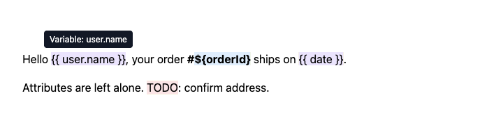

<div align="center">

# glowmark

**Highlight search terms, `{{variables}}`, `${templates}` or any pattern in your content, with tooltips. Your HTML is never changed. Zero dependencies, any framework.**

[](https://www.npmjs.com/package/glowmark)
[](https://bundlephobia.com/package/glowmark)
[](package.json)
[](src/index.ts)
[](#license)

**[▶ Try the live demo](https://shiv7700.github.io/glowmark/)**



</div>

---

## Why glowmark?

You have some content, like an email template, a CMS block or a prompt preview, and you want its placeholders to **stand out and explain themselves on hover**. You don't want a library rewriting your markup to do it.

- 🔍 **Search highlighting built in.** `words(['react', 'hooks'])` handles case and special characters for you.
- ✨ **Your HTML stays exactly as you rendered it.** Matches are *painted* by the browser (the [CSS Custom Highlight API](https://developer.mozilla.org/en-US/docs/Web/API/CSS_Custom_Highlight_API)), not wrapped in `<span>` or `<mark>`.
- 🧩 **Works with any framework.** Your framework renders the content and glowmark attaches to the element. Use it with React, Vue, Svelte, Angular or no framework.
- 📝 **HTML or plain text.** glowmark reads the text on the page, so it doesn't matter where the text came from.
- 🔄 **Follows changes.** When the content re-renders, the highlights update on their own.
- 🪶 **Tiny.** About 2 kB minified and gzipped, with zero dependencies.
- 🛡️ **Safe.** It only reads text, never tags, attributes, or `<script>`/`<style>`/`<textarea>` contents. Tooltip text is always shown as plain text.
- 🔷 **TypeScript.** Types are included.

## Use cases

- 🔍 **Search results:** highlight the words a user searched for, as they type.
- ✉️ **Template previews:** emails, notifications and prompts with `{{variables}}` explained on hover.
- 📚 **Docs and blogs:** explain terms like "SSR" or "API" when the reader hovers over them.
- 🧪 **Editors and CMS:** flag placeholders, TODOs or banned words without touching the editor's DOM.

## Contents

- [Installation](#installation)
- [Quick start](#quick-start)
- [Framework guides](#framework-guides)
- [API](#api)
- [Recipes](#recipes)
- [Styling](#styling)
- [Browser support](#browser-support)
- [Accessibility](#accessibility)
- [Comparison](#comparison)
- [FAQ](#faq)
- [Contributing](#contributing)
- [License](#license)

## Installation

```sh
npm install glowmark
# or
pnpm add glowmark
# or
yarn add glowmark
```

Or use it from a CDN, with no build step:

```html
<link rel="stylesheet" href="https://cdn.jsdelivr.net/npm/glowmark/style.css" />
<script type="module">
  import { glowmark, mustache } from 'https://cdn.jsdelivr.net/npm/glowmark/+esm';
</script>
```

## Quick start

```html
<div id="preview">
  <p>Hello {{ user.name }}, your order is ${orderId}.</p>
</div>
```

```js
import { glowmark, mustache, template } from 'glowmark';
import 'glowmark/style.css'; // optional default colors and tooltip look

const destroy = glowmark(document.querySelector('#preview'), [
  mustache({ tooltip: (m) => `Variable: ${m.groups[0]}` }),
  template({ tooltip: (m) => `Template value: ${m.groups[0]}` }),
]);

// later, to remove everything:
destroy();
```

That's the whole API: one function. Render your content however you normally would, then point glowmark at it.

## Framework guides

In each example, define `rules` **outside** the component so it isn't recreated on every render.

<details>
<summary><b>React</b></summary>

```jsx
import { useEffect, useRef } from 'react';
import { glowmark } from 'glowmark';

export function Preview({ html }) {
  const ref = useRef(null);
  useEffect(() => glowmark(ref.current, rules), []);

  return <div ref={ref} dangerouslySetInnerHTML={{ __html: html }} />;
  // or, for a plain string: return <div ref={ref}>{text}</div>;
}
```

This works with SSR (Next.js and others) as is, because glowmark only runs inside `useEffect`.

</details>

<details>
<summary><b>Vue</b></summary>

```vue
<script setup>
import { onMounted, onUnmounted, ref } from 'vue';
import { glowmark } from 'glowmark';

defineProps({ html: String });
const el = ref();

let destroy;
onMounted(() => (destroy = glowmark(el.value, rules)));
onUnmounted(() => destroy());
</script>

<template>
  <div ref="el" v-html="html" />
</template>
```

</details>

<details>
<summary><b>Svelte 5</b></summary>

```svelte
<script>
  import { glowmark } from 'glowmark';

  let { html } = $props();
  let el;
  $effect(() => glowmark(el, rules));
</script>

<div bind:this={el}>{@html html}</div>
```

</details>

<details>
<summary><b>Angular</b></summary>

```ts
import { AfterViewInit, Component, ElementRef, Input, OnDestroy, ViewChild } from '@angular/core';
import { glowmark } from 'glowmark';

@Component({ selector: 'app-preview', template: '<div #box [innerHTML]="html"></div>' })
export class PreviewComponent implements AfterViewInit, OnDestroy {
  @Input() html = '';
  @ViewChild('box') box!: ElementRef<HTMLElement>;
  private destroy?: () => void;

  ngAfterViewInit() { this.destroy = glowmark(this.box.nativeElement, rules); }
  ngOnDestroy() { this.destroy?.(); }
}
```

</details>

<details>
<summary><b>Vanilla JS</b></summary>

```js
glowmark(document.querySelector('#preview'), rules);
```

</details>

## API

### `glowmark(root, rules)`

```ts
function glowmark(root: HTMLElement, rules: Rule[]): () => void;
```

Highlights every rule match in the text inside `root` and shows the rule's tooltip when the mouse is over a match, when it's tapped, or when the text cursor is inside it.

- **The DOM is never changed.** `root.innerHTML` is the same before and after.
- **It follows changes.** When the content inside `root` changes, the highlights update automatically.
- **The tooltip hides** when the mouse leaves the match, on a press outside the element, when the text cursor leaves the match, on <kbd>Esc</kbd>, or on scroll. A tooltip the text cursor opened isn't closed by mouse movement.
- **It returns `destroy()`**, which removes the highlights, the tooltip and every listener.

When matches overlap, **the one that starts first wins**. If two start at the same place, **the rule listed first wins**, so the order of your rules sets their priority.

### `Rule`

```ts
interface Rule {
  name: string;                       // used in CSS: ::highlight(glowmark-<name>)
  pattern: RegExp;                    // the "g" flag is added if missing
  tooltip?: (match: Match) => string; // plain text, read on hover; return '' for no tooltip
}

interface Match {
  text: string;     // the full match, e.g. "{{ name }}"
  groups: string[]; // capture groups, e.g. ["name"]; a group that didn't match is ""
}
```

`name` is used in a CSS selector, so it must be a valid CSS identifier: letters, digits, `-` or `_`.

### Presets

| Preset              | Matches        | `groups[0]`         |
| ------------------- | -------------- | ------------------- |
| `mustache(options)` | `{{ name }}`   | `name`, trimmed     |
| `template(options)` | `${ name }`    | `name`, trimmed     |
| `words(list, options)` | any of `list`, as literal text | none (use `m.text`) |

`options` can set any `Rule` field except `pattern`:

```js
mustache({ tooltip: (m) => m.groups[0], name: 'variable' });
```

`words(list, options)` is for search terms:

- **Literal text.** Characters like `$`, `.` and `(` match themselves, so there's nothing to escape.
- **Case.** It ignores letter case by default. Pass `{ caseSensitive: true }` to match case exactly.
- **Longer terms win.** If you search for `react` and `react hooks`, the text "react hooks" is highlighted as one match.
- **Blank terms are ignored**, and an empty list highlights nothing.
- **Its rule name is `search`**, so you style it with `::highlight(glowmark-search)`.

### TypeScript

```ts
import type { Rule, Match, PresetOptions, WordsOptions } from 'glowmark';
```

## Recipes

### Search as you type

Rules are fixed when you call `glowmark()`, so for a new search, destroy the old highlight and create a new one. This is cheap.

```js
import { glowmark, words } from 'glowmark';

let stopSearch = () => {};
searchInput.addEventListener('input', () => {
  stopSearch();
  stopSearch = glowmark(results, [words(searchInput.value.split(/\s+/))]);
});
```

```css
::highlight(glowmark-search) { background-color: #fde047; }
```

In React, pass the terms as an effect dependency:

```jsx
useEffect(() => glowmark(ref.current, [words(terms)]), [terms.join(' ')]);
```

### Custom rule: `@mentions`

```js
const mention = {
  name: 'mention',
  pattern: /@(\w+)/g,
  tooltip: (m) => `User: ${m.groups[0]}`,
};

glowmark(el, [mention]);
```

```css
::highlight(glowmark-mention) { background-color: #dcfce7; }
```

### Look up tooltip text

The tooltip function runs **on hover**, so it always reads your latest data:

```js
const docs = { 'user.name': "The customer's full name", orderId: 'Order number' };

mustache({ tooltip: (m) => docs[m.groups[0]] ?? '' }); // unknown variables: highlight, no tooltip
```

### Rich text editors

Because glowmark never touches the DOM, it's safe to use on a `contenteditable` area or an editor's output, as long as the editor doesn't mind other code reading its text.

```js
glowmark(editor.view.dom, rules);
```

### Untrusted HTML

glowmark doesn't render anything, so sanitizing is up to whatever renders the content. If you put user HTML on the page, sanitize it first:

```js
import DOMPurify from 'dompurify';

el.innerHTML = DOMPurify.sanitize(userHtml);
glowmark(el, rules);
```

## Styling

The stylesheet is optional:

```js
import 'glowmark/style.css';
```

Matches are styled with the `::highlight()` CSS pseudo-element:

| Selector                         | Targets                                       |
| -------------------------------- | --------------------------------------------- |
| `::highlight(glowmark)`          | every match (the default look)                |
| `::highlight(glowmark-<name>)`   | matches from the rule `<name>`, drawn on top  |
| `.glowmark-tooltip`              | the tooltip                                   |

```css
::highlight(glowmark-todo) {
  background-color: #ffe4e6;
  text-decoration: underline wavy #e11d48;
}
```

> **Note:** inside `::highlight()`, browsers only allow `color`, `background-color`, `text-decoration` and `text-shadow`. Padding, borders and rounded corners aren't supported.

| CSS variable                 | Default   |
| ---------------------------- | --------- |
| `--glowmark-bg`              | `#fff3a3` |
| `--glowmark-mustache-bg`     | `#ede4ff` |
| `--glowmark-template-bg`     | `#dcefff` |
| `--glowmark-tooltip-bg`      | `#111827` |
| `--glowmark-tooltip-fg`      | `#fff`    |
| `--glowmark-tooltip-z`       | `9999`    |

If you skip the stylesheet, write your own `::highlight(glowmark)` rule, or the matches won't be colored. Tooltip placement still works without it.

## Browser support

Colors use the CSS Custom Highlight API: Chrome/Edge 105+, Safari 17.2+, Firefox 140+ (from [MDN's compatibility data](https://developer.mozilla.org/en-US/docs/Web/API/Highlight#browser_compatibility)).

In older browsers, nothing breaks: the text just isn't colored, and **tooltips still work**.

glowmark needs `document`, so call it in the browser (for example in `useEffect` or `onMounted`), not during server rendering.

## Accessibility

Painted highlights are not elements, so glowmark opens tooltips in three ways:

- **Mouse:** hover over a match.
- **Touch:** tap a match. Tap outside the element to close it.
- **Keyboard:** move the text cursor inside a match (not just next to it), for example in an editor or with caret browsing (<kbd>F7</kbd>). The tooltip stays open while you type in the match, even if the mouse moves.

Screen readers read the text normally, without the highlight. The tooltip is a polite live region, so its text is announced when it opens.

Inside shadow DOM, hover and tap work, but text-cursor tooltips don't, because `document.getSelection()` can't see into a shadow root.

If your users need the tooltip content, show it somewhere else on the page as well. Don't rely on the tooltip alone for important information.

## Comparison

|                                   | glowmark | Interweave | mark.js | react-highlight-words |
| --------------------------------- | :------: | :--------: | :-----: | :-------------------: |
| Leaves your DOM unchanged         |    ✅    |     ❌     |   ❌    |          ❌           |
| Works with any framework          |    ✅    | ❌ (React) |   ✅    |      ❌ (React)       |
| Search-term highlighting          |    ✅    |     ❌     |   ✅    |          ✅           |
| Built-in tooltips                 |    ✅    |     ❌     |   ❌    |          ❌           |
| `{{}}` / `${}` presets            |    ✅    |     ❌     |   ❌    |          ❌           |
| Zero dependencies                 |    ✅    |     ❌     |   ✅    |          ❌           |

Need to highlight search terms in browsers from before 2023? Use mark.js. Need to render React components inside HTML? Use Interweave. Need placeholders in your content to stand out, with explanations on hover? That's what glowmark is for.

## FAQ

#### Why isn't `{{ a <b>b</b> }}` highlighted?

Matching works on one text node at a time, so a match can't cross tags.

#### Do I need to call glowmark again when my content changes?

No. glowmark watches `root` and updates the highlights when its content changes. Call it once per element, and call `destroy()` when the element goes away.

#### Can tooltips contain HTML or components?

No. Tooltip content is plain text, so it can never inject HTML. If you need rich content, show it elsewhere in your UI.

#### The tooltip disappears when I scroll. Is that a bug?

No, it's intentional. The tooltip closes on scroll instead of following the match. Hover again to reopen it.

## Contributing

```sh
npm install
npm test            # unit tests (Vitest + jsdom)
npm run typecheck
npm run build
```

Read [AGENTS.md](AGENTS.md) for project rules and layout, [docs/architecture.md](docs/architecture.md) for how it works, and [docs/decisions.md](docs/decisions.md) for why it works that way.

## License

[MIT](LICENSE)
